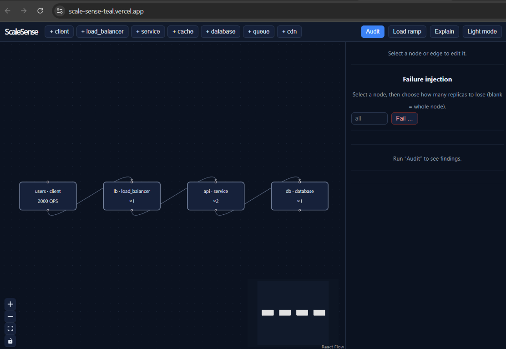
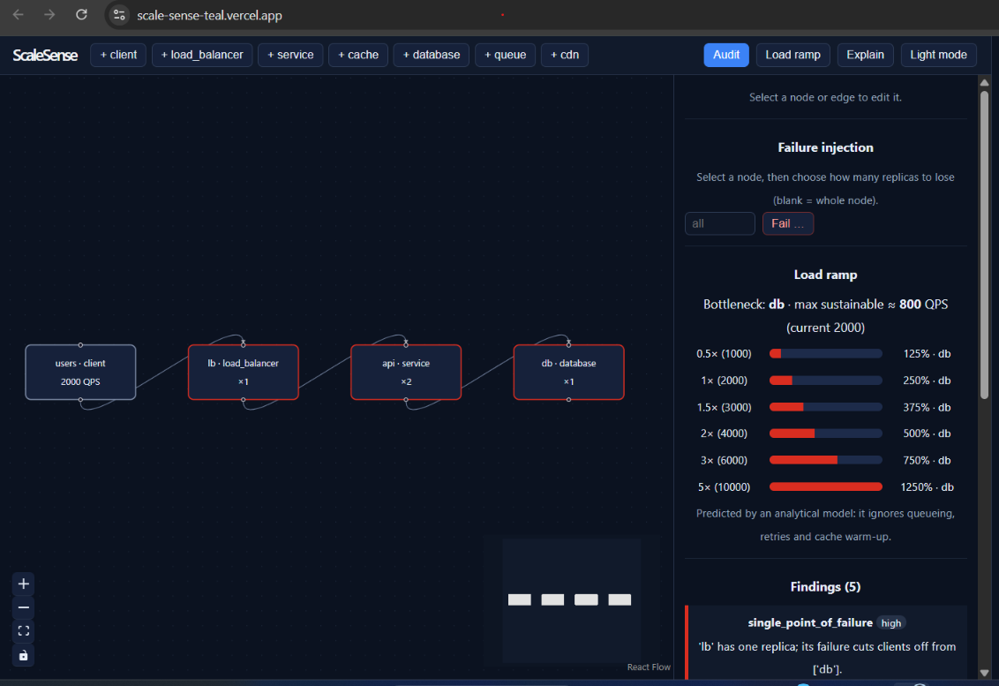

# ScaleSense

Design a system on a canvas, then get an automatic architecture review: single points of failure,
overloaded components, risky call chains, plus what-if simulation and cited explanations.

**Live demo:** https://scale-sense-teal.vercel.app
(the backend runs on a free tier, so the first request after a pause can take up to a minute)

## Screenshots

**The starting design: a three-tier system (client, load balancer, API, database)**



**After running Audit and Load ramp: risky components get red borders, with the bottleneck and the utilization curve on the right**



## What it does

- **Audit**: a rule engine over the architecture graph finds single points of failure
  (graph reachability), saturation (QPS propagated through load balancers, caches and
  fan-out), long synchronous chains, cycles (Tarjan's SCC), unbuffered databases,
  consumer-less queues and request amplification.
- **Failure injection**: kill a node or some of its replicas and see which data stores
  become unreachable and which nodes become newly overloaded.
- **Load ramp**: find the bottleneck and the maximum sustainable QPS.
- **Explain**: each finding is matched to a short knowledge-base passage with a citation id,
  using hybrid retrieval (BM25 plus character-trigram similarity, fused with reciprocal rank
  fusion) and a verifier that checks every cited snippet exists in its source chunk.
- Light and dark themes.

## Tech stack

FastAPI and Pydantic (backend), React, Vite and React Flow (frontend), pytest (19 tests),
Docker Compose with nginx, Redis, Postgres and k6 (load testing). Deployed on Render
(backend) and Vercel (frontend).

## Architecture

- `backend/` FastAPI. `analyzer.py` (graph algorithms), `capacity.py` (analytical load model,
  Little's Law), `rules.py` (rule engine), `simulate.py` (failure and ramp),
  `retrieval.py` and `verify.py` (knowledge base search and citation check).
- `frontend/` React Flow canvas with an inspector, audit panel, failure injection and
  ramp chart.
- `loadtest/` Docker Compose stack and k6 scripts used to validate the model against a real
  system.
- `scripts/` benchmark generator and evaluators.

## Run locally

Backend (Command Prompt):

```bat
cd backend
python -m venv .venv
.venv\Scripts\activate
pip install -r requirements.txt
python -m pytest -q
uvicorn app.main:app --reload
```

Frontend (second terminal):

```bat
cd frontend
npm install
npm run dev
```

Open http://localhost:5173 (API docs at http://localhost:8000/docs).

Environment variables:
- `ALLOWED_ORIGINS` (backend): comma-separated allowed frontend origins.
- `VITE_API_URL` (frontend, build time): the backend URL.

## Evaluation

**Rule engine** on a seeded-flaw benchmark of 7 designs: precision 1.00, recall 1.00, 0 false
alarms on the clean design. I wrote the cases, so this shows the rules do what I intended,
not that they generalize.

**Retrieval** (12 queries, 7-document knowledge base): hit@1 = 12/12. This is a smoke test:
the knowledge base and the queries were written together.

**Model vs. a real load test.** One API replica was calibrated (0.5 CPU cap, 350 requests/s
used as its capacity), then the model's predictions were compared with k6 measurements on
a 2-replica Docker stack behind nginx. "Last clean rate" means 0% failures and no dropped
iterations.

| Scenario | Predicted | Measured | Error |
|---|---|---|---|
| 2 replicas, all cached, capacity | 700 req/s | last clean 600, collapse at 700 | about 17% over |
| 1 replica, all cached | 350 (calibration) | last clean 400, collapse at 500 | calibration about 13% low |
| Lose 1 of 2 replicas at 500 req/s | api overloaded (143%) | 1 replica collapses (71% failures) | direction and point of failure match |
| 2 replicas, 90% cache hit rate | 700 req/s | last clean 400 | about 75% over |

The single-replica knee varied between 300 and 400 across repeated runs, so differences
under about 15% are within measurement noise. One 2-replica run at 500 req/s failed while 600
passed, which I treat as a transient, so the 2-replica knee is a range of 600 to 700.

## Limitations

- The capacity model assumes every request costs the same. A cache miss in the real stack
  cost the API far more than a hit, so the model over-predicts capacity when the hit rate
  is below 100%.
- The model is steady-state: no queueing delay, retries, cache warm-up or autoscaling.
- Load tests ran on one laptop where the load generator, nginx, Redis and Postgres share
  the host with the API replicas.
- Retrieval is lexical and trigram-based, not neural, and the knowledge base is small.
- The citation verifier currently guards extractive snippets. It matters more if generated
  summaries are added.

## Lessons from the load test

- `docker compose run` silently scaled the API back to one replica, which made the first
  2-replica results meaningless. Replica counts are now checked before and after every
  measurement, and a run is marked INVALID if the count changes.